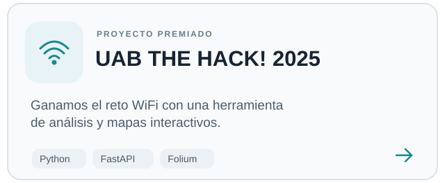
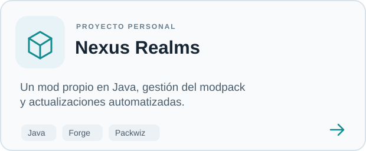
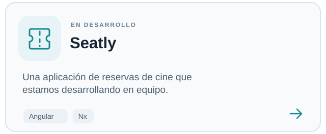
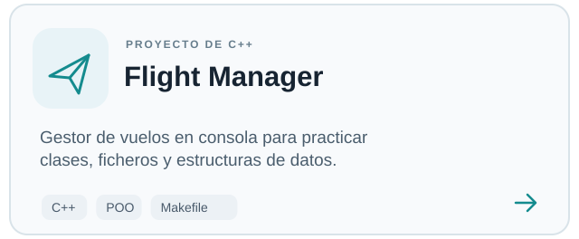

<h1 align="center">
  Hola, soy Carlos 
</h1>

  Estudio <b>Ingeniería Informática en la UAB</b> y trabajo como <b>desarrollador web</b>.

  <picture>
    <source media="(prefers-color-scheme: dark)" srcset="https://readme-typing-svg.demolab.com/?font=Inter&weight=500&size=20&duration=3000&pause=1600&center=true&vCenter=true&repeat=true&width=820&height=48&lines=Ganamos%20el%20WiFi%20Challenge%20en%20UAB%20THE%20HACK%21%202025;Nexus%20Realms%2C%20un%20proyecto%20de%20Minecraft%20en%20Java;Me%20gusta%20programar%20y%20experimentar%20con%20hardware&color=8FCFD0" />
    <source media="(prefers-color-scheme: light)" srcset="https://readme-typing-svg.demolab.com/?font=Inter&weight=500&size=20&duration=3000&pause=1600&center=true&vCenter=true&repeat=true&width=820&height=48&lines=Ganamos%20el%20WiFi%20Challenge%20en%20UAB%20THE%20HACK%21%202025;Nexus%20Realms%2C%20un%20proyecto%20de%20Minecraft%20en%20Java;Me%20gusta%20programar%20y%20experimentar%20con%20hardware&color=247A86" />
    
  </picture>

  
  
  
  
  

---

## Sobre mí

En el trabajo desarrollo y mantengo webs y tiendas online. Por mi cuenta también hago proyectos de software, pruebo herramientas nuevas y, cuando tengo tiempo, trasteo con electrónica e impresión 3D.

## Proyectos

<!-- Dos columnas equilibradas. La separación procede de los márgenes internos de las imágenes SVG. -->

<a href="https://github.com/itsCarlosDev/UAB-THE-HACK-2025-WiFi-Challenge-Winner"><picture><source media="(prefers-color-scheme: dark)" srcset="./assets/hack-dark.svg" /><source media="(prefers-color-scheme: light)" srcset="./assets/hack-light.svg" /></picture></a><a href="https://github.com/itsCarlosDev/nexus-realms-pack"><picture><source media="(prefers-color-scheme: dark)" srcset="./assets/nexus-dark.svg" /><source media="(prefers-color-scheme: light)" srcset="./assets/nexus-light.svg" /></picture></a>

<a href="https://github.com/itsCarlosDev/Seatly"><picture><source media="(prefers-color-scheme: dark)" srcset="./assets/seatly-dark.svg" /><source media="(prefers-color-scheme: light)" srcset="./assets/seatly-light.svg" /></picture></a><a href="https://github.com/itsCarlosDev/flight-manager-cpp-oop-graphs"><picture><source media="(prefers-color-scheme: dark)" srcset="./assets/flight-dark.svg" /><source media="(prefers-color-scheme: light)" srcset="./assets/flight-light.svg" /></picture></a>

También participé en [INTERHACK BCN](https://github.com/Francois0405/LosCaptcha_InterHack), en un prototipo de logística desarrollado en equipo.

## Tecnologías

**Web y aplicaciones**

  
  &nbsp;
  
  &nbsp;
  
  &nbsp;
  
  &nbsp;
  
  &nbsp;
  
  &nbsp;
  
  &nbsp;
  

**Programación y datos**

  
  &nbsp;
  
  &nbsp;
  
  &nbsp;
  
  &nbsp;
  

**Herramientas**

  
  &nbsp;
  
  &nbsp;
  
  &nbsp;
  
  &nbsp;
  

**También me interesa:** ESP32, CAD, impresión 3D y automatización de servidores.
